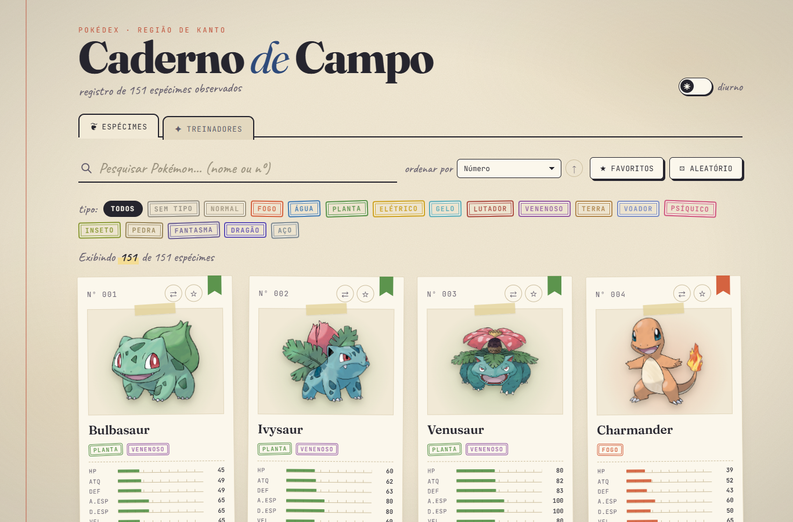
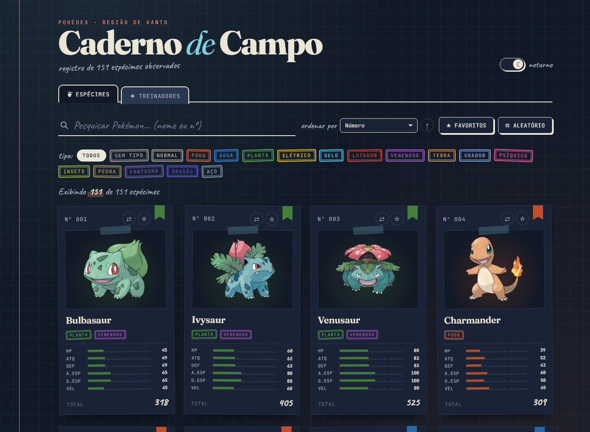
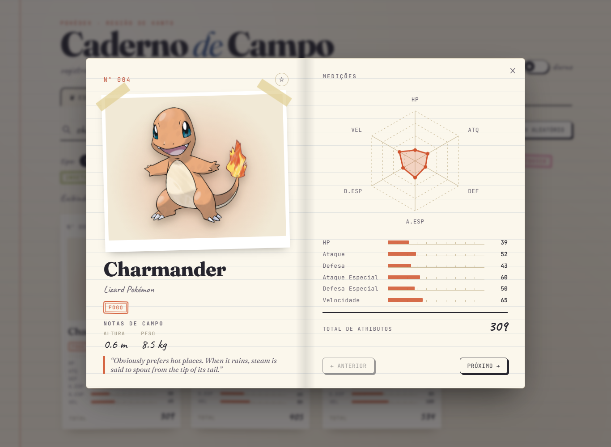
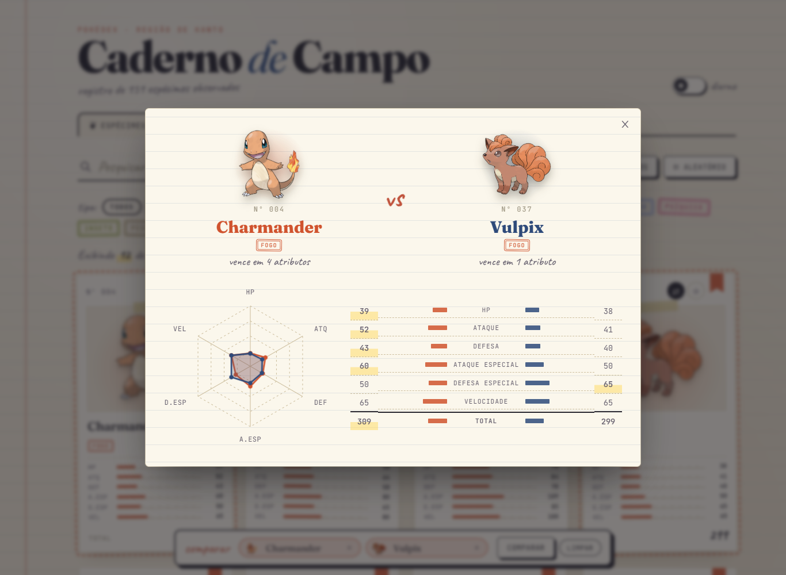
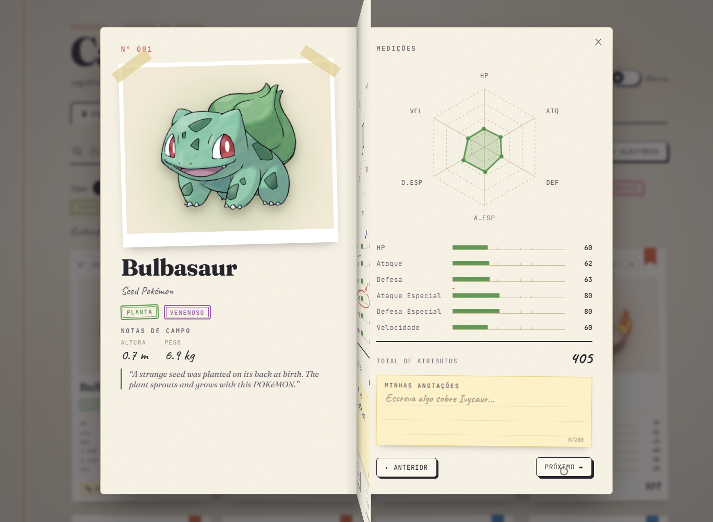
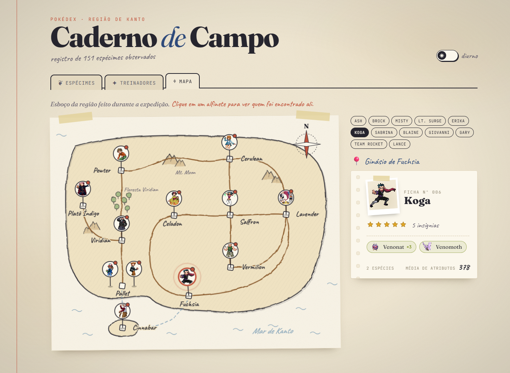
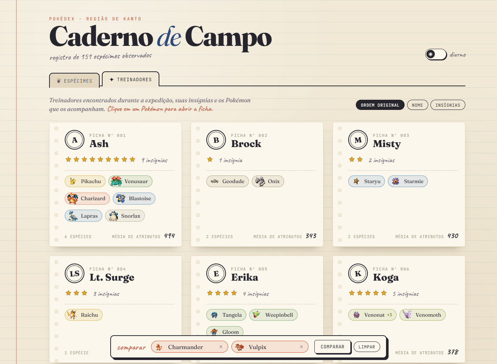

# 📓 Caderno de Campo — Pokédex Full Stack (React + Spring Boot + MongoDB)

**Integrantes do Grupo:**
- Pedro José Camilo
- Cairo Rezende

Pokédex interativa desenvolvida com **React + Vite** (Atividade 03) e integrada a uma **API REST em Spring Boot** com banco **MongoDB** (Atividade 04) para a disciplina de Desenvolvimento e Integração de Aplicações Web.

Em vez da clássica Pokédex vermelha, a interface foi pensada como o **caderno de campo de um naturalista**: cada Pokémon é uma *ficha de espécime* com foto presa por fita adesiva, os tipos aparecem como **carimbos**, os atributos são medidos em **réguas graduadas** e o fundo imita **papel envelhecido** com granulação e manchas suaves. No tema escuro, o caderno vira um **laboratório noturno** azul-noite.

<div align="center">
  
  
</div>

---

## ✨ Funcionalidades

### Obrigatórias
- 🐾 **Listagem** dos 151 Pokémon vindos da API (MongoDB), com número, nome, tipos e os seis atributos (HP, Ataque, Defesa, Ataque Especial, Defesa Especial e Velocidade).
- 🔎 **Pesquisa em tempo real** por nome (`bulba`) ou número (`25`, `#025`, `nº 25`).
- 🧬 **Filtro por tipo** gerado a partir dos tipos presentes nos dados (inclui “Sem tipo”, usado pelo Mew).
- 📄 **Detalhes em modal** (caderno aberto) com gráfico radar dos atributos, barras, total, treinadores que possuem o Pokémon e navegação anterior/próximo (também pelas setas do teclado; `Esc` fecha).
- 🧑‍🚀 **Treinadores**: fichas com foto, nome, insígnias, equipe (IDs repetidos são agrupados, ex.: Venonat ×3 do Koga), busca por treinador ou Pokémon da equipe, filtro por insígnias e média de atributos. Clicar em um Pokémon abre a ficha dele.
- ⚠️ **Estado vazio** quando nenhum Pokémon corresponde à pesquisa/filtros, com botão para limpar.
- 📱 **Layout responsivo** para desktop, tablet e smartphone.

### Desafios opcionais implementados
- ⭐ **Favoritos** salvos no `localStorage`, com filtro “somente favoritos”.
- 📊 **Ordenação** por número, nome, cada atributo ou total — crescente ou decrescente.
- 🎲 **Pokémon aleatório** (sorteado dentre os que estão sendo exibidos).
- ⚔️ **Comparação** entre dois Pokémon com radar sobreposto e tabela destacando quem vence cada atributo.
- 🌙 **Tema claro/escuro** salvo no navegador.
- 🌐 **API externa (PokéAPI)** para complementar os detalhes com altura, peso, categoria e descrição.

### Interações do caderno de campo
- 📖 **Página virando de verdade**: ao navegar com “anterior/próximo” (ou pelas setas do teclado), a folha gira em 3D pela lombada, mostrando na frente a página atual e no verso a seguinte.
- 🧪 **Reações elementais**: cálculo de fraquezas (`2×`, `4×`), resistências (`½×`, `¼×`) e imunidades (`0×`) a partir dos tipos do espécime.
- 🔄 **Linha evolutiva interativa**: diagrama com os estágios evolutivos de Kanto no modal; clicar em outra fase da evolução vira a página diretamente para aquele Pokémon.
- ⚑ **Equipe de expedição**: recrutamento de até 6 Pokémon (salvo no `localStorage`) com perfil médio em gráfico radar, soma de atributos, cobertura de tipos e alerta de vulnerabilidades compartilhadas.
- 🗺️ **Mapa de Kanto desenhado à mão**: contorno com traço tremido, rotas que se desenham sozinhas, montanhas, floresta e rosa dos ventos. Cada treinador é um alfinete com foto na sua cidade; clicar nele abre a ficha ao lado.
- ✍️ **Minhas anotações**: um bloco de notas em cada Pokémon, salvo automaticamente no navegador, com filtro rápido “Com notas” na barra principal e etiqueta na ficha da listagem.
- 🖍️ **Marcações à mão animadas**: no detalhe, o maior atributo é circulado (“ponto forte!”) e o menor é sublinhado (“ponto fraco”), como se fosse feito a caneta.
- ✏️ **Cursor de lápis**: o cursor vira um lápis e cada clique deixa um rabisco rápido no papel.

<div align="center">
  
  
  
  
  
  
</div>

---

## 🏗️ Arquitetura (Atividade 04)

A Pokédex da Atividade 03 deixou de ler o `pokedex-data.json` e agora é uma aplicação **Full Stack**:

```text
Script_Pokedex.sql (dados de origem)
        ↓
     MongoDB
        ↓
Spring Boot REST API   (backend/)
        ↓
   React + Vite        (frontend/)
```

- **MongoDB**: coleções `pokemons`, `types` e `trainers`. Os dados do script SQL da atividade foram convertidos para o modelo de documentos (`backend/src/main/resources/seed/*.json`) e são carregados automaticamente na primeira execução, quando as coleções estão vazias.
- **Spring Boot**: camadas `controller` → `service` → `repository` → `model`, com validação, tratamento de erros (`400`, `404`, `409`) e CORS configurável.
- **React + Vite**: mesma interface da Atividade 03, agora buscando tudo da API (`src/api/pokedexApi.js` + hook `usePokedexData`), com tela de carregamento/erro e formulário de cadastro/edição.

### Modelo dos documentos

```json
// coleção pokemons
{
  "_id": 25,
  "name": "Pikachu",
  "stats": { "hp": 35, "attack": 55, "defense": 30, "specialAttack": 50, "specialDefense": 40, "speed": 90 },
  "types": [{ "id": 5, "name": "Electric" }]
}

// coleção trainers (a relação treinador × Pokémon fica embutida; ids repetidos = vários exemplares)
{ "_id": 6, "name": "Koga", "badges": 5, "pokemonIds": [48, 48, 48, 49] }

// coleção types
{ "_id": 5, "name": "Electric" }
```

O `_id` é o próprio número da Pokédex, então a URL de um Pokémon é simplesmente `/api/pokemons/25`.

### 🌐 Endpoints da API

| Método | Endpoint | Descrição |
| --- | --- | --- |
| `GET` | `/api/pokemons` | Lista todos os Pokémon (filtros opcionais: `?name=pika`, `?type=Fire`) |
| `GET` | `/api/pokemons/{id}` | Busca um Pokémon pelo ID |
| `POST` | `/api/pokemons` | Cadastra um Pokémon (sem `id` no corpo, usa o próximo número livre) |
| `PUT` | `/api/pokemons/{id}` | Atualiza um Pokémon |
| `DELETE` | `/api/pokemons/{id}` | Remove um Pokémon |
| `GET` | `/api/types` | Lista os tipos |
| `GET` | `/api/trainers` | Lista os treinadores (filtros opcionais: `?name=ash`, `?pokemonId=25`) |
| `GET` | `/api/trainers/{id}` | Busca um treinador pelo ID |

Exemplo de corpo para `POST /api/pokemons`:

```json
{
  "name": "Pikachu Alola",
  "stats": { "hp": 35, "attack": 55, "defense": 40, "specialAttack": 50, "specialDefense": 50, "speed": 90 },
  "types": [{ "id": 5, "name": "Electric" }]
}
```

Os atributos devem estar entre 1 e 255 e o nome é obrigatório; caso contrário a API responde `400` com a mensagem do erro.

### ➕ Cadastro, edição e exclusão

- **Cadastrar**: botão **＋ Novo espécime** na barra da listagem abre um formulário (nome, até 2 tipos e os 6 atributos).
- **Editar / Excluir**: dentro da ficha de qualquer Pokémon, os botões **✎ Editar** e **🗑 Excluir** (com confirmação).

Todas as alterações passam pela API REST e ficam persistidas no MongoDB.

---

## ▶️ Como executar

Pré-requisitos: **Node.js 20+**, **JDK 21+** e uma instância de **MongoDB** (Atlas ou local). O Maven não precisa estar instalado: o projeto inclui o Maven Wrapper (`mvnw`).

### 1. Configurar o MongoDB

A aplicação lê a conexão da variável de ambiente **`MONGODB_URI`**. As credenciais **nunca** são commitadas — o arquivo `backend/.env.example` mostra o formato.

**Opção A — MongoDB Atlas (recomendado)**

1. Crie uma conta e um cluster gratuito (M0) em [mongodb.com/atlas](https://www.mongodb.com/atlas).
2. Em **Database Access**, crie um usuário e uma senha.
3. Em **Network Access**, libere o seu IP (ou `0.0.0.0/0` apenas para testes).
4. Em **Database → Connect → Drivers**, copie a connection string e inclua o nome do banco `pokedex`:

   ```text
   mongodb+srv://<usuario>:<senha>@<cluster>.mongodb.net/pokedex?retryWrites=true&w=majority
   ```

**Opção B — MongoDB local**

Com o MongoDB rodando na porta padrão, não é preciso configurar nada: a aplicação usa `mongodb://localhost:27017/pokedex` por padrão.

> No primeiro start, o backend cria o banco `pokedex` e popula as coleções automaticamente. Coleções que já têm dados não são sobrescritas.

### 2. Iniciar o backend (porta 8080)

```bash
cd backend

# Linux / macOS / Git Bash
export MONGODB_URI="mongodb+srv://<usuario>:<senha>@<cluster>.mongodb.net/pokedex?retryWrites=true&w=majority"
./mvnw spring-boot:run

# Windows (PowerShell)
$env:MONGODB_URI = "mongodb+srv://<usuario>:<senha>@<cluster>.mongodb.net/pokedex?retryWrites=true&w=majority"
.\mvnw.cmd spring-boot:run
```

Teste rapidamente: abra `http://localhost:8080/api/pokemons/25` no navegador (ou use Postman/Insomnia).

Para rodar os testes: `./mvnw test`.

### 3. Iniciar o frontend (porta 5173)

Em outro terminal:

```bash
cd frontend

# 1. instalar as dependências
npm install

# 2. iniciar o servidor de desenvolvimento
npm run dev
```

Abra `http://localhost:5173`. Em desenvolvimento, o Vite redireciona `/api` para `http://localhost:8080` (ver `frontend/vite.config.js`). Para apontar para outra API, defina `VITE_API_URL` (ex.: `VITE_API_URL=https://minha-api.com/api`).

Outros comandos do frontend:

```bash
npm run build     # gera a versão de produção na pasta dist/
npm run preview   # serve a versão de produção localmente
```

### Variáveis de ambiente

| Variável | Onde | Padrão | Descrição |
| --- | --- | --- | --- |
| `MONGODB_URI` | backend | `mongodb://localhost:27017/pokedex` | Connection string do MongoDB |
| `CORS_ALLOWED_ORIGINS` | backend | `http://localhost:5173` | Origens liberadas no CORS (separadas por vírgula) |
| `VITE_API_URL` | frontend | `/api` | URL base da API |

---

## 📁 Dados utilizados

Os dados da Pokédex vêm do **MongoDB**, servidos pela API. Eles foram originados do script SQL fornecido na atividade (Pokémon, tipos, relação Pokémon × tipo, treinadores e relação treinador × Pokémon) e convertidos para documentos em `backend/src/main/resources/seed/`:

- `types.json` — 18 tipos
- `pokemons.json` — 151 Pokémon com `id`, `name`, `stats` e `types`
- `trainers.json` — 12 treinadores com `name`, `badges` e `pokemonIds`

As fontes externas abaixo são usadas apenas para complementar a parte visual:

| Recurso | Fonte | Uso |
| --- | --- | --- |
| Imagens oficiais | [PokeAPI/sprites](https://github.com/PokeAPI/sprites) — `sprites/pokemon/other/official-artwork/{id}.png` | Fotos dos cards e do modal |
| Sprites pixelados | [PokeAPI/sprites](https://github.com/PokeAPI/sprites) — `sprites/pokemon/{id}.png` | Treinadores, evolução, bandeja de comparação e reserva caso a imagem oficial falhe |
| Fotos dos treinadores | [Pokémon Showdown](https://play.pokemonshowdown.com/sprites/trainers/) — `sprites/trainers/{nome}.png` | Foto de cada treinador na seção Treinadores (o Gary usa o sprite `blue`, nome dele nos jogos) |
| Dados complementares | [PokéAPI](https://pokeapi.co/) — `/api/v2/pokemon/{id}` e `/api/v2/pokemon-species/{id}` | Altura, peso, categoria e descrição no modal |

Se não houver internet, as imagens dos Pokémon são substituídas por uma ilustração de “?”, as dos treinadores pelas iniciais do nome, e o modal informa que está exibindo apenas os dados locais.

---

## 🧩 Organização do projeto

```text
pokedex/
├── backend/                          # API REST (Spring Boot + MongoDB)
│   ├── pom.xml
│   ├── mvnw / mvnw.cmd               # Maven Wrapper
│   ├── .env.example                  # modelo das variáveis de ambiente
│   └── src/
│       ├── main/java/br/puc/pokedex/
│       │   ├── PokedexApplication.java
│       │   ├── controller/           # PokemonController, TypeController, TrainerController
│       │   ├── service/              # PokemonService (regras de negócio)
│       │   ├── repository/           # interfaces Spring Data MongoDB
│       │   ├── model/                # Pokemon, Stats, TypeRef, PokemonType, Trainer
│       │   ├── exception/            # 404/409/400 em formato JSON
│       │   ├── config/               # CORS
│       │   └── seed/                 # DataSeeder: popula o MongoDB na primeira execução
│       ├── main/resources/
│       │   ├── application.properties
│       │   └── seed/                 # types.json, pokemons.json, trainers.json
│       └── test/                     # testes dos dados de seed
├── frontend/                         # React + Vite
│   ├── public/
│   │   └── favicon.svg
│   ├── src/
│   │   ├── api/
│   │   │   └── pokedexApi.js         # cliente da API REST (fetch)
│   │   ├── components/
│   │   │   ├── Header.jsx            # cabeçalho, abas e alternador de tema
│   │   │   ├── ApiStatus.jsx         # carregando / erro de conexão com a API
│   │   │   ├── SearchBar.jsx         # campo de pesquisa
│   │   │   ├── TypeFilter.jsx        # filtro por tipo (carimbos)
│   │   │   ├── SortSelect.jsx        # ordenação
│   │   │   ├── PokemonList.jsx       # grade de fichas (map)
│   │   │   ├── PokemonCard.jsx       # ficha de espécime
│   │   │   ├── PokemonDetails.jsx    # modal de detalhes e folha virando
│   │   │   ├── PokemonForm.jsx       # cadastro e edição de Pokémon
│   │   │   ├── JournalPages.jsx      # páginas esquerda e direita do caderno
│   │   │   ├── TypeWeaknesses.jsx    # fraquezas, resistências e imunidades elementais
│   │   │   ├── EvolutionChain.jsx    # diagrama interativo de linha evolutiva
│   │   │   ├── ExpeditionTeam.jsx    # montagem e análise da equipe de expedição
│   │   │   ├── NotePad.jsx           # minhas anotações
│   │   │   ├── Scribble.jsx          # marcações à mão animadas
│   │   │   ├── KantoMap.jsx          # mapa de Kanto com os treinadores
│   │   │   ├── PencilCursor.jsx      # rabiscos do cursor de lápis
│   │   │   ├── StatBar.jsx           # barra de atributo (régua)
│   │   │   ├── StatRadar.jsx         # gráfico radar em SVG
│   │   │   ├── TypeStamp.jsx         # carimbo de tipo
│   │   │   ├── Trainers.jsx          # seção de treinadores com busca e filtro
│   │   │   ├── TrainerCard.jsx       # ficha de treinador
│   │   │   ├── CompareTray.jsx       # bandeja de comparação
│   │   │   ├── CompareModal.jsx      # comparação lado a lado
│   │   │   ├── ThemeToggle.jsx       # tema claro/escuro
│   │   │   └── EmptyState.jsx        # nenhum resultado
│   │   ├── css/                      # um arquivo de estilo por área da interface
│   │   ├── data/
│   │   │   ├── evolutions.js         # famílias evolutivas dos 151 Pokémon de Kanto
│   │   │   └── kantoMap.js           # cidades, rotas e locais dos treinadores
│   │   ├── hooks/
│   │   │   ├── usePokedexData.js     # carrega e altera os dados via API
│   │   │   ├── useLocalStorage.js    # useState persistido
│   │   │   ├── useFavorites.js
│   │   │   ├── useNotes.js           # anotações pessoais
│   │   │   ├── useTeam.js            # equipe de expedição (até 6 Pokémon)
│   │   │   ├── useTheme.js
│   │   │   └── usePokemonExtra.js    # busca na PokéAPI com useEffect
│   │   ├── utils/
│   │   │   ├── filters.js            # pesquisa, filtro e ordenação
│   │   │   ├── stats.js              # atributos, total e formatação do número
│   │   │   ├── trainerImage.js       # fotos dos treinadores (Pokémon Showdown)
│   │   │   ├── trainers.js           # agrupamento da equipe de cada treinador
│   │   │   ├── typeColors.js         # cores e nomes em português dos tipos
│   │   │   ├── typeEffectiveness.js  # matriz de eficácia elemental defensiva
│   │   │   └── pokemonImage.js       # URLs das imagens e fallback
│   │   ├── App.jsx                   # estado principal e composição da tela
│   │   ├── main.jsx
│   │   └── index.css                 # variáveis de tema e estilos globais
│   ├── index.html
│   ├── package.json
│   └── vite.config.js
├── docs/screenshots/                 # imagens usadas neste README
└── README.md
```

### Conceitos de React aplicados
- **Componentes funcionais** e **props** para toda a interface.
- **`useState`** para pesquisa, filtros, ordenação, seleção, comparação e abas.
- **`useMemo`** para o estado derivado (lista filtrada e ordenada, análise da equipe e busca de treinadores).
- **`useEffect`** para carregar os dados da API, teclado/rolagem do modal, persistência no `localStorage`, tema e chamadas à PokéAPI (com `AbortController`).
- **Hooks personalizados** (`usePokedexData`, `useLocalStorage`, `useFavorites`, `useNotes`, `useTeam`, `useTheme`, `usePokemonExtra`).
- **Renderização de listas** com `map()` e **eventos** de clique, teclado e formulário.

---

## 🛠️ Tecnologias

- [React 19](https://react.dev/)
- [Vite](https://vite.dev/)
- [Spring Boot 3](https://spring.io/projects/spring-boot) (Spring Web, Spring Data MongoDB, Validation) com Java 21
- [MongoDB](https://www.mongodb.com/) (Atlas ou local)
- CSS puro (variáveis, grid, `color-mix`, animações) — sem bibliotecas de UI
- Fontes [Fraunces](https://fonts.google.com/specimen/Fraunces), [JetBrains Mono](https://fonts.google.com/specimen/JetBrains+Mono) e [Caveat](https://fonts.google.com/specimen/Caveat) (Google Fonts)

> Pokémon e seus nomes são marcas de Nintendo / Game Freak / The Pokémon Company. Projeto com fins exclusivamente acadêmicos.
