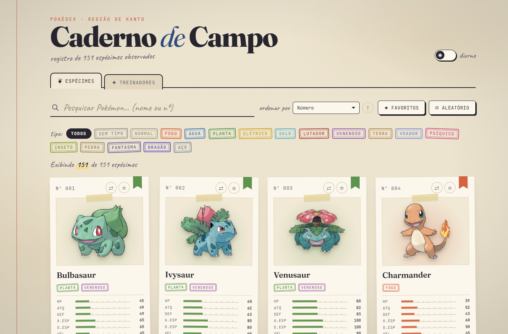
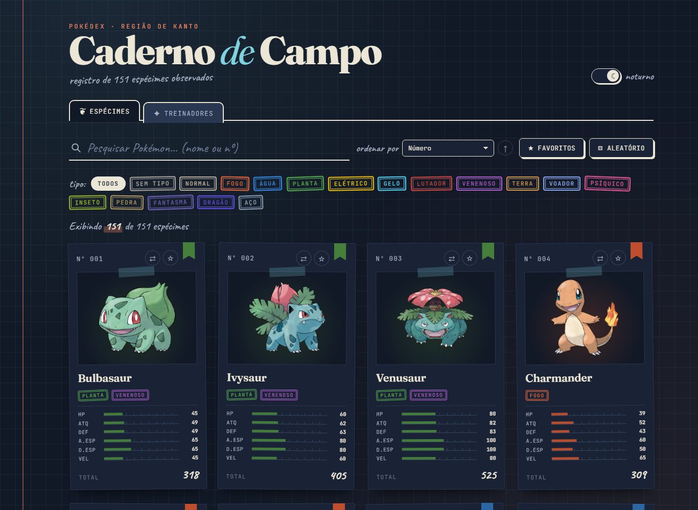
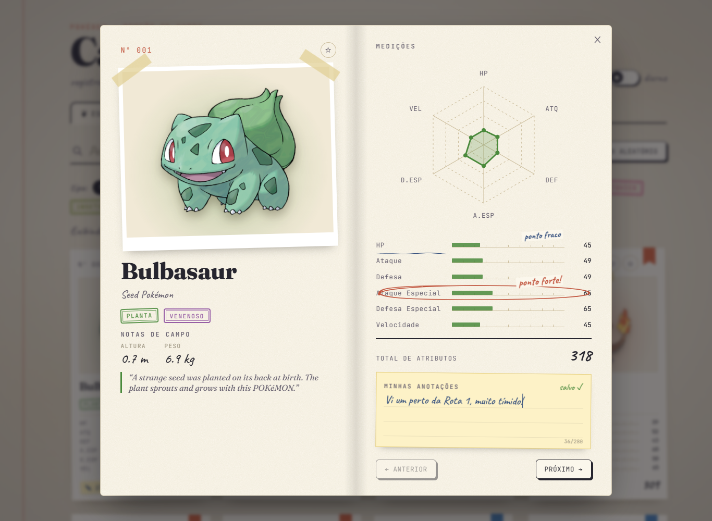
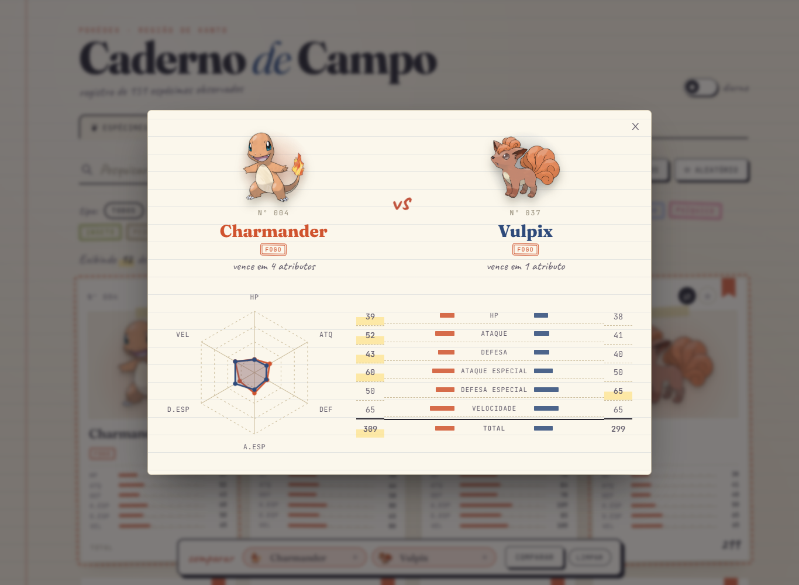
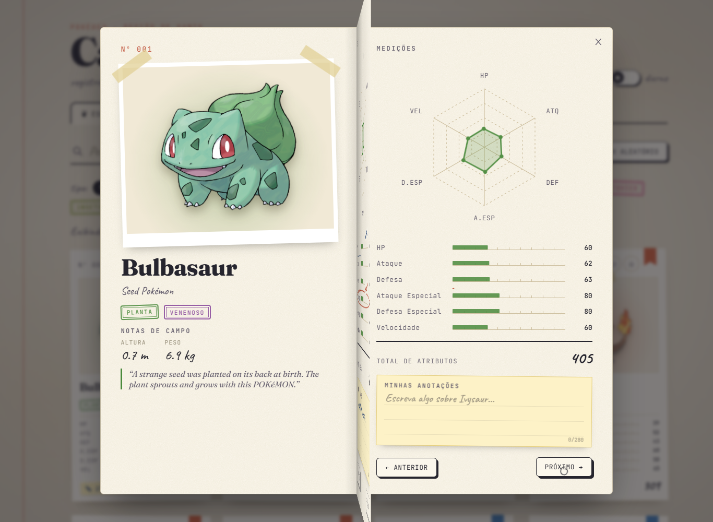
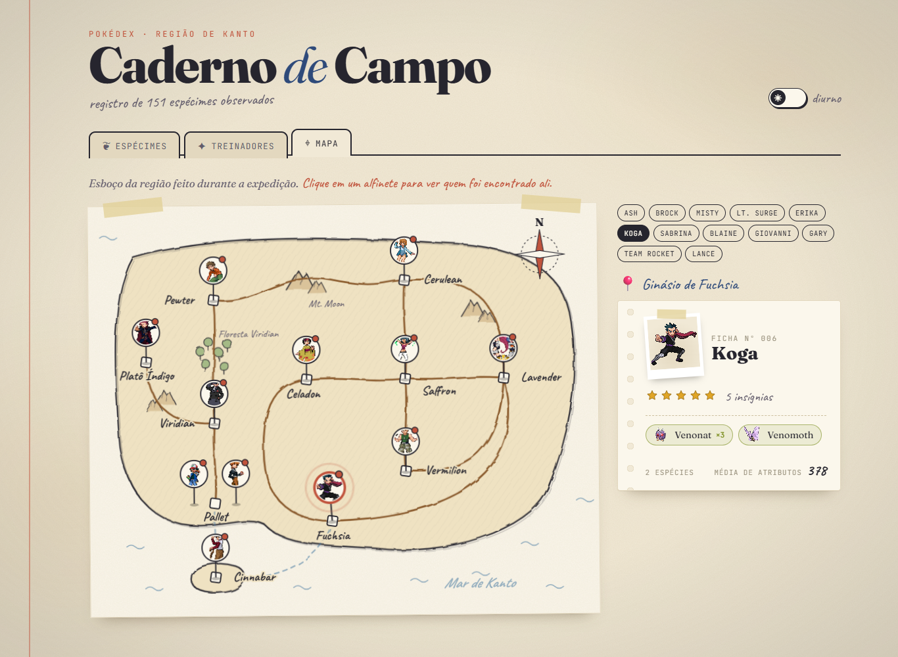
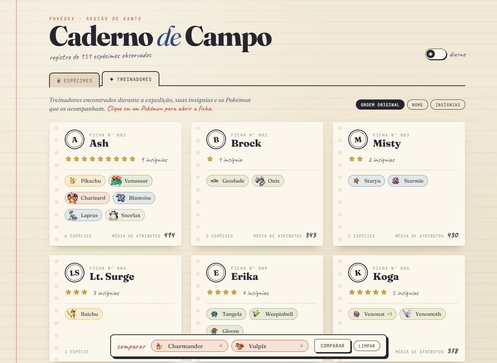
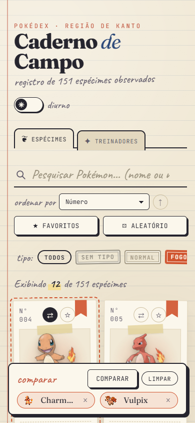

# 📓 Caderno de Campo — Pokédex com React + Vite

Pokédex interativa desenvolvida com **React + Vite** para a Atividade 03 da disciplina de Desenvolvimento e Integração de Aplicações Web.

Em vez da clássica Pokédex vermelha, a interface foi pensada como o **caderno de campo de um naturalista**: cada Pokémon é uma *ficha de espécime* com foto presa por fita adesiva, os tipos aparecem como **carimbos**, os atributos são medidos em **réguas graduadas** e o fundo imita **papel envelhecido** com granulação e manchas suaves. No tema escuro, o caderno vira um **laboratório noturno** azul-noite.

<div align="center">
  
  
</div>

---

## ✨ Funcionalidades

### Obrigatórias
- 🐾 **Listagem** dos 151 Pokémon do arquivo `pokedex-data.json`, com número, nome, tipos e os seis atributos (HP, Ataque, Defesa, Ataque Especial, Defesa Especial e Velocidade).
- 🔎 **Pesquisa em tempo real** por nome (`bulba`) ou número (`25`, `#025`, `nº 25`).
- 🧬 **Filtro por tipo** gerado a partir dos tipos presentes nos dados (inclui “Sem tipo”, usado pelo Mew).
- 📄 **Detalhes em modal** (caderno aberto) com gráfico radar dos atributos, barras, total, treinadores que possuem o Pokémon e navegação anterior/próximo (também pelas setas do teclado; `Esc` fecha).
- 🧑‍🚀 **Treinadores**: fichas com foto, nome, insígnias, equipe (IDs repetidos são agrupados, ex.: Venonat ×3 do Koga) e média de atributos. Clicar em um Pokémon abre a ficha dele.
- ⚠️ **Estado vazio** quando nenhum Pokémon corresponde à pesquisa/filtros, com botão para limpar.
- 📱 **Layout responsivo** para desktop, tablet e smartphone.

### Desafios opcionais implementados
- ⭐ **Favoritos** salvos no `localStorage`, com filtro “somente favoritos”.
- 📊 **Ordenação** por número, nome, cada atributo ou total — crescente ou decrescente.
- 🎲 **Pokémon aleatório** (sorteado dentre os que estão sendo exibidos).
- ⚔️ **Comparação** entre dois Pokémon com radar sobreposto e tabela destacando quem vence cada atributo.
- 🌙 **Tema claro/escuro** salvo no navegador.
- 🌐 **API externa (PokéAPI)** para complementar os detalhes com altura, peso, categoria e descrição.

### Interações do caderno de campo
- 📖 **Página virando de verdade**: ao navegar com “anterior/próximo” (ou pelas setas do teclado), a folha gira em 3D pela lombada, mostrando na frente a página atual e no verso a seguinte.
- 🗺️ **Mapa de Kanto desenhado à mão**: contorno com traço tremido, rotas que se desenham sozinhas, montanhas, floresta e rosa dos ventos. Cada treinador é um alfinete com foto na sua cidade; clicar nele abre a ficha ao lado.
- ✍️ **Minhas anotações**: um bloco de notas em cada Pokémon, salvo automaticamente no navegador. A nota também aparece como etiqueta na ficha da listagem.
- 🖍️ **Marcações à mão animadas**: no detalhe, o maior atributo é circulado (“ponto forte!”) e o menor é sublinhado (“ponto fraco”), como se fosse feito a caneta.
- ✏️ **Cursor de lápis**: o cursor vira um lápis e cada clique deixa um rabisco rápido no papel.

<div align="center">
  
  
  
  
  
  
</div>

---

## ▶️ Como executar

Pré-requisito: **Node.js 20+** (com npm).

```bash
# 1. instalar as dependências
npm install

# 2. iniciar o servidor de desenvolvimento
npm run dev
```

Depois abra no navegador o endereço exibido no terminal, normalmente:

```
http://localhost:5173
```

Outros comandos:

```bash
npm run build     # gera a versão de produção na pasta dist/
npm run preview   # serve a versão de produção localmente
```

---

## 📁 Dados utilizados

Os dados da aplicação ficam em **`src/data/pokedex-data.json`** (arquivo fornecido na atividade) e são importados diretamente pelo `App.jsx`. O arquivo contém:

- `types` — lista de tipos (`id`, `name`)
- `pokemon` — 151 Pokémon com `id`, `name`, `stats` e `types`
- `trainers` — 12 treinadores com `name`, `badges` e `pokemonIds`

A Pokédex funciona completamente com esse arquivo. As fontes externas abaixo são usadas apenas para complementar a parte visual:

| Recurso | Fonte | Uso |
| --- | --- | --- |
| Imagens oficiais | [PokeAPI/sprites](https://github.com/PokeAPI/sprites) — `sprites/pokemon/other/official-artwork/{id}.png` | Fotos dos cards e do modal |
| Sprites pixelados | [PokeAPI/sprites](https://github.com/PokeAPI/sprites) — `sprites/pokemon/{id}.png` | Treinadores, bandeja de comparação e reserva caso a imagem oficial falhe |
| Fotos dos treinadores | [Pokémon Showdown](https://play.pokemonshowdown.com/sprites/trainers/) — `sprites/trainers/{nome}.png` | Foto de cada treinador na seção Treinadores (o Gary usa o sprite `blue`, nome dele nos jogos) |
| Dados complementares | [PokéAPI](https://pokeapi.co/) — `/api/v2/pokemon/{id}` e `/api/v2/pokemon-species/{id}` | Altura, peso, categoria e descrição no modal |

Se não houver internet, as imagens dos Pokémon são substituídas por uma ilustração de “?”, as dos treinadores pelas iniciais do nome, e o modal informa que está exibindo apenas os dados locais.

---

## 🧩 Organização do projeto

```text
pokedex/
├── public/
│   └── favicon.svg
├── docs/screenshots/          # imagens usadas neste README
├── src/
│   ├── components/
│   │   ├── Header.jsx         # cabeçalho, abas e alternador de tema
│   │   ├── SearchBar.jsx      # campo de pesquisa
│   │   ├── TypeFilter.jsx     # filtro por tipo (carimbos)
│   │   ├── SortSelect.jsx     # ordenação
│   │   ├── PokemonList.jsx    # grade de fichas (map)
│   │   ├── PokemonCard.jsx    # ficha de espécime
│   │   ├── PokemonDetails.jsx # modal de detalhes e folha virando
│   │   ├── JournalPages.jsx   # páginas esquerda e direita do caderno
│   │   ├── NotePad.jsx        # minhas anotações
│   │   ├── Scribble.jsx       # marcações à mão animadas
│   │   ├── KantoMap.jsx       # mapa de Kanto com os treinadores
│   │   ├── PencilCursor.jsx   # rabiscos do cursor de lápis
│   │   ├── StatBar.jsx        # barra de atributo (régua)
│   │   ├── StatRadar.jsx      # gráfico radar em SVG
│   │   ├── TypeStamp.jsx      # carimbo de tipo
│   │   ├── Trainers.jsx       # seção de treinadores
│   │   ├── TrainerCard.jsx    # ficha de treinador
│   │   ├── CompareTray.jsx    # bandeja de comparação
│   │   ├── CompareModal.jsx   # comparação lado a lado
│   │   ├── ThemeToggle.jsx    # tema claro/escuro
│   │   └── EmptyState.jsx     # nenhum resultado
│   ├── css/                   # um arquivo de estilo por área da interface
│   ├── data/
│   │   ├── pokedex-data.json
│   │   └── kantoMap.js        # cidades, rotas e locais dos treinadores
│   ├── hooks/
│   │   ├── useLocalStorage.js # useState persistido
│   │   ├── useFavorites.js
│   │   ├── useNotes.js        # anotações pessoais
│   │   ├── useTheme.js
│   │   └── usePokemonExtra.js # busca na PokéAPI com useEffect
│   ├── utils/
│   │   ├── filters.js         # pesquisa, filtro e ordenação
│   │   ├── stats.js           # atributos, total e formatação do número
│   │   ├── trainerImage.js    # fotos dos treinadores (Pokémon Showdown)
│   │   ├── trainers.js        # agrupamento da equipe de cada treinador
│   │   ├── typeColors.js      # cores e nomes em português dos tipos
│   │   └── pokemonImage.js    # URLs das imagens e fallback
│   ├── App.jsx                # estado principal e composição da tela
│   ├── main.jsx
│   └── index.css              # variáveis de tema e estilos globais
├── index.html
├── package.json
└── vite.config.js
```

### Conceitos de React aplicados
- **Componentes funcionais** e **props** para toda a interface.
- **`useState`** para pesquisa, filtros, ordenação, seleção, comparação e abas.
- **`useMemo`** para o estado derivado (lista filtrada e ordenada).
- **`useEffect`** para teclado/rolagem do modal, persistência no `localStorage`, tema e chamadas à PokéAPI (com `AbortController`).
- **Hooks personalizados** (`useLocalStorage`, `useFavorites`, `useTheme`, `usePokemonExtra`).
- **Renderização de listas** com `map()` e **eventos** de clique, teclado e formulário.

---

## 🛠️ Tecnologias

- [React 19](https://react.dev/)
- [Vite](https://vite.dev/)
- CSS puro (variáveis, grid, `color-mix`, animações) — sem bibliotecas de UI
- Fontes [Fraunces](https://fonts.google.com/specimen/Fraunces), [JetBrains Mono](https://fonts.google.com/specimen/JetBrains+Mono) e [Caveat](https://fonts.google.com/specimen/Caveat) (Google Fonts)

> Pokémon e seus nomes são marcas de Nintendo / Game Freak / The Pokémon Company. Projeto com fins exclusivamente acadêmicos.
